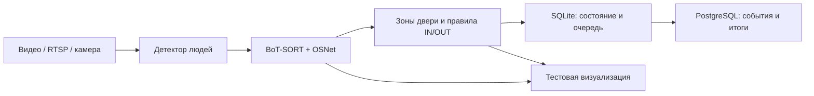

# Bus Passenger Counter

## Ветки репозитория

- [diploma](https://github.com/F3nd1uwu/bus_passenger_counter/tree/diploma) —
  полная версия: исходники, тесты, обучение, документация и протоколы экспериментов.
  [Путеводитель для диплома](docs/THESIS.md), [сводка результатов](docs/RESULTS.md).
- [server](https://github.com/F3nd1uwu/bus_passenger_counter/tree/server) —
  серверная поставка с тремя рабочими ONNX-моделями и инструкцией эксплуатации,
  без обучающих инструментов, аналитических архивов и экспериментальных весов.

`main` на момент публикации соответствует полной версии. Серверную ветку собирают
из зафиксированного коммита полной версии; происхождение и хеши файлов входят
в `release.json`. [Как обновлять обе ветки](docs/REPOSITORY.md).

Подсчёт входящих и выходящих пассажиров по видеофайлу, RTSP-потоку или USB-камере.
Система обнаруживает людей, сопровождает их через дверной проём, исключает повторные
проходы одного направления в течение часа и сохраняет события и дневные итоги в PostgreSQL.

[](https://github.com/F3nd1uwu/bus_passenger_counter/actions/workflows/ci.yml)

**Текущий статус:** рабочий прототип с воспроизводимыми проверками. На независимой
выборке исходного профиля v1 найдено **47 из 53 проходов**: полнота **88,68%**, precision **100%**,
F1 **94,00%**. Надёжность распознавания повторных проходов в течение часа на длинной
реальной записи пока не подтверждена. По умолчанию фильтр персонала отключён.
Для камеры из `test2.mp4` подготовлен отдельный экспериментальный профиль с дообученным
детектором людей и моделью рабочей жилетки. [Проверка нового профиля](reports/test2-2026-11-13/REPORT.md),
[исходные результаты и ограничения](docs/QUALITY.md).
В первоначальной проверке восьми выбранных эпизодов профиль нашёл 20 из 28 пассажирских
проходов и исключил три прохода водителя. Пропуски и смены личности остаются;
полный файл автоматически не обработан. Старые 25 контрольных эпизодов дают
правильные итоги, но уже использовались для настройки.

**Обновление 14 ноября:** дообучение на подготовленном CountPeople проверено,
но новые веса людей не включены: итоги совпали только в 20/25 старых контролей.
В `test2` обновлён фильтр жилетки v3 и исправлены отдельные перескоки ID.
На дополнительной новой проверке найдено 5/7 проходов; надёжность часового
узнавания всё ещё не достигнута. [Обучение, ошибки и протокол](reports/countpeople-candidate-v1/README.md).

**Последующее исправление без новых материалов:** в `test2` уточнена граница
салона и добавлена защита от передачи ID при слиянии боксов соседних людей.
P02: 7/10 входов вместо 6/10; P04: 4/5 проходов вместо 3/5. В прежних восьми
эпизодах теперь найдено 21/28 проходов; все 25 старых контролей сохранены.
На пяти проверках пар людей исправлена одна склейка, сохранены четыре связи
того же человека. Это проверки настройки одной камеры, а не точность за день.
[Актуальный отчёт и ограничения](reports/id-continuity-2026-11-14/README.md).

**Экспериментальный фильтр детей:** добавлен отдельный режим приблизительного
распознавания маленьких детей с правилом «при сомнении учитывать».
На шести проверенных фрагментах он сохранил прежние итоги, но **не исключил ни одного
ребёнка**. Эффективность для этой камеры пока не подтверждена; по умолчанию режим
отключён. [Как включить и что проверено](docs/CHILD_FILTER.md).

## Возможности

- **Два режима:** `main.py` — служба с PostgreSQL и восстановлением состояния;
  `test_local.py` — визуальная проверка без записи в БД и рабочее состояние.
- **Подсчёт IN/OUT:** подтверждённый переход между двумя зонами двери;
  появление человека в кадре и дрожание бокса сами по себе не считаются проходом.
- **Память личности:** OSNet ReID, галерея ракурсов, отдельное часовое окно для IN и OUT.
- **Отказоустойчивость:** локальный SQLite-журнал, очередь недоставленных событий,
  контрольная точка в PostgreSQL, повторная доставка с защитой от двойного увеличения итогов.
- **Предпросмотр:** боксы, ID, зоны, счётчики, скорость обработки, ползунок перемотки,
  стрелки, пауза и сохранение видео с визуализацией.
- **Развёртывание:** Docker Compose, CPU-образ, непривилегированный пользователь,
  постоянные тома и ротация логов.

## Как считается пассажиропоток

При `ENTER_FROM=street` переход из зоны улицы в салон даёт IN, обратный — OUT.
Одному человеку разрешён один учитываемый IN и один учитываемый OUT за 3600 секунд
**независимо по каждому направлению**. Первый OUT после IN учитывается.
Повторное событие сохраняется в журнале с `counted=false`, но не увеличивает итог
и не продлевает часовое окно.

Поэтому IN — число входов с часовым исключением повторов, а не число уникальных людей
за день. **IN − OUT не является текущим количеством людей в салоне.** Качество часового
исключения зависит от сохранения личности: ReID может ошибаться, особенно после
поворотов, перекрытий и смены освещения.

Рабочую жилетку определяет отдельная обученная модель на чёрно-белом изображении:
цветовой фильтр не используется. В обычном режиме `STAFF_MODE=disabled`; профиль
`test2` включает экспериментальную модель конкретной жилетки. Это не универсальное
распознавание профессии и не проверка возраста пассажира.

## Быстрый локальный запуск

Рекомендуется **Python 3.12**. Локально также проверяется Python 3.14.
Необходимые модели/экспорты включены в репозиторий; видео и датасет — нет.

### Windows PowerShell

```powershell
git clone https://github.com/F3nd1uwu/bus_passenger_counter.git
cd bus_passenger_counter
py -3.12 -m venv .venv
.\.venv\Scripts\python.exe -m pip install --upgrade pip
.\.venv\Scripts\python.exe -m pip install --no-deps --index-url https://download.pytorch.org/whl/cpu torch==2.15.0 torchvision==0.29.2
.\.venv\Scripts\python.exe -m pip install -r requirements.txt
```

Поместите свою запись в `data/test.mp4` и запустите проверенный профиль:

```powershell
.\.venv\Scripts\python.exe test_local.py --source data/test.mp4 --model models/candidates/person_manual_v1.onnx --confidence 0.35 --association-similarity 0.70 --show
```

Если уже есть окружение `venv`, используйте `venv\Scripts\python.exe` вместо `.venv`.
Для нового видео с водителем в жилетке:

```powershell
.\venv\Scripts\python.exe test_local.py --source data/test2.mp4 --profile test2 --show
```

Пробный запуск фильтра детей без записи в БД:

```powershell
.\venv\Scripts\python.exe test_local.py --source data/test2.mp4 --profile test2 --child-mode model --show
```

`CHILD` означает подтверждённое визуальное предположение о маленьком ребёнке;
его IN и OUT сохраняются с `counted=false`. `AGE?` означает недостаток признаков:
возрастной фильтр такого пассажира не исключает. Численный возраст не показывается.
Решение может ожидать дополнительные кадры до 10 секунд видео. Этот режим
увеличивает нагрузку на CPU; [результаты проверки](reports/child-filter-2026-11-14/README.md).

Профиль задаёт модели и пороги, сохраняя локальные настройки БД и источника.
Явные параметры командной строки имеют приоритет: например, `--staff-mode disabled`
позволяет сравнить результат без исключения персонала. На сервере используется тот же
`--profile test2` у `main.py`; для смены модели нужна отдельная `STATE_PATH`, поскольку
рабочая контрольная точка привязана к весам и настройкам.

В окне `ID` обозначает траекторию, `P:` — запомненную личность. Серый бокс `WEAK`
поддерживает сопровождение, но не подтверждает проход. `PENDING` означает, что решение
ещё ожидает признаки жилетки или включённого возрастного фильтра: до 10 секунд видео, обычно до исчезновения человека
и истечения срока жизни траектории. В журнал сохраняется время прохода, а не время
принятия отложенного решения.

Для Linux команды аналогичны: `python3.12 -m venv .venv`, затем `.venv/bin/python`.
На сервере без монитора используйте `--output` вместо `--show`:

```bash
.venv/bin/python test_local.py --source data/test.mp4 --model models/candidates/person_manual_v1.onnx --confidence 0.35 --association-similarity 0.70 --output data/preview.mp4
```

Управление в окне:

| Действие | Управление |
| --- | --- |
| Перемотка к кадру | Ползунок `Frame` |
| Назад / вперёд на 5 секунд | Стрелки влево / вправо |
| Пауза / продолжение | Пробел |
| Выход | Q, Esc или закрытие окна |

После перемотки тестовые счётчики и память сбрасываются; `COUNT FROM` показывает
начало текущего участка подсчёта. Для живого потока перемотка отключена.
При `--output` в файл записываются просмотренные участки в порядке воспроизведения.

Дополнительные режимы:

```powershell
# Только детекция, без ReID и подсчёта
.\.venv\Scripts\python.exe test_local.py --source data/test.mp4 --detection-only --show

# Ограниченный участок с сохранением результата
.\.venv\Scripts\python.exe test_local.py --source data/test.mp4 --model models/candidates/person_manual_v1.onnx --confidence 0.35 --association-similarity 0.70 --start-frame 465750 --max-frames 1351 --output data/check_A12.mp4

# USB-камера; для RTSP используйте --source-kind stream и URL своей камеры
.\.venv\Scripts\python.exe test_local.py --source 0 --source-kind camera --model models/candidates/person_manual_v1.onnx --confidence 0.35 --association-similarity 0.70 --show
```

## Полный запуск через Docker

Нужны Docker Engine / Docker Desktop с Compose. Python для подготовки `.env` может
быть системным: эта команда использует только стандартную библиотеку.

```bash
python -m tools.setup_env
```

Команда создаёт `.env` со случайным паролем и **сохраняет существующий файл**.
В новом шаблоне выбран профиль `person_manual_v1` с порогами 0,35 / 0,70.
Локальные настройки уже работающей установки автоматически не меняются.

Для видеофайла укажите в `.env`:

```dotenv
VIDEO_SOURCE=/app/data/test.mp4
SOURCE_KIND=file
# Реальное время первого кадра с часовым поясом; ниже только пример:
VIDEO_START=2026-11-01T05:40:00+04:00
```

Для камеры вместо этого:

```dotenv
VIDEO_SOURCE=rtsp://camera-host/stream
SOURCE_KIND=stream
VIDEO_START=
```

После настройки источника и зон:

```bash
docker compose up --build -d
docker compose logs -f counter_service
```

PostgreSQL в основном Compose не открывает порт наружу. Модели и видео монтируются
только для чтения; состояние хранится в `counter_state`, PostgreSQL — в `pgdata`.
Не удаляйте эти тома при перезапуске. После завершения файла служба успешно
останавливается; поток работает постоянно. Полный порядок запуска, SQL-запросы,
локальная служба с БД и резервное копирование: [развёртывание](docs/DEPLOYMENT.md).

## Проверенное качество

Независимый аудит от **08.11.2026**: 16 новых эпизодов, **21 066 кадров**,
**14 минут 03,47 секунды**, одна камера и один день. Разметка выполнена по исходным
кадрам до просмотра прогнозов; все события модели затем сопоставлены с конкретными людьми.

| События | Вручную | Модель | Пропуски | Лишние | Precision | Recall | F1 |
| --- | ---: | ---: | ---: | ---: | ---: | ---: | ---: |
| IN | 24 | 20 | 4 | 0 | 100% | 83,33% | 90,91% |
| OUT | 29 | 27 | 2 | 0 | 100% | 93,10% | 96,43% |
| Всего | 53 | 47 | 6 | 0 | 100% | 88,68% | 94,00% |

Полностью совпали оба счётчика в **13/16 эпизодов (81,25%)**. Недосчёт — **11,32%**.
Все пропуски относятся к A01, A02 и A12: темнота, частичные боксы, перекрытия и разрыв
истории перехода между разными треками. У одного человека подтверждён разный
`identity_id` между входом и выходом.

Преимущественно проверялись выбранные сценарии; три дополнительных окна выбраны
случайно. Это **не оценка точности за весь день**. Подтверждённых повторных IN→IN
или OUT→OUT с проверкой часа в этой выборке нет; между окнами память сбрасывалась.
YOLO mAP и точность боксов этим аудитом не измерялись.

[Все 16 эпизодов и шесть пропусков](reports/independent-audit-2026-11-08/README.md) ·
[Каждое ручное событие](reports/independent-audit-2026-11-08/event_matching.csv) ·
[Машиночитаемый результат](reports/independent-audit-2026-11-08/results.json)

### Обучение и предыдущие проверки

- Вручную размечены **350 изображений / 341 бокс**: train 187, val 82, test 81.
  Ещё 16 неоднозначных кадров исключены.
- Детектор дообучен от YOLO26n: **23 эпохи, лучшая — 15-я**. ReID не дообучалась.
- На 81 тестовом кадре при IoU 0,50 F1 боксов вырос с **0,634 до 0,765**.
  Это отдельная метрика детектора, её нельзя смешивать с качеством подсчёта проходов.
- На шести эпизодах настройки после исправлений трекера итог совпал с ручным:
  **20 IN / 11 OUT**. Эти эпизоды использовались для разработки и не являются
  независимым подтверждением качества.

Подробные TP/FP/FN, параметры обучения, история регрессий и границы выводов —
в [описании качества](docs/QUALITY.md).

### Производительность

Независимый прогон на **AMD Ryzen 7 5700U**, CPU, 4 потока, FP32 640 px,
с ReID и записью визуализации: **20,50 FPS в среднем**, средние по эпизодам
**18,52–22,36 FPS**. Это не минимальная мгновенная скорость и не замер сервера.

При исходных 24,98 FPS каждый кадр обрабатывается примерно в **1,22 раза медленнее
реального времени**. Для 60 FPS запаса нет: в зависимости от источника и буфера
возникнут задержки или пропуски кадров. Скорость и качество при снижении частоты
обработки нужно проверять отдельно на целевом сервере.

Экранные часы внутри записи не равны скорости обработки. В предоставленном архиве
они скачут относительно времени файла; для часового правила нужен исходный поток
или достоверная временная шкала записи.

## Архитектура и хранение



| Хранилище | Назначение |
| --- | --- |
| `raw_passenger_events` | Все события, личность, направление, причина учёта/исключения |
| `daily_passenger_traffic` | День, автобус, входы (`total_passengers`) и выходы (`total_out`) |
| `current_day_passenger_traffic` | Накопительные итоги по дню, автобусу и камере |
| `counter_runtime_state` | Контрольная точка: личности, часовые окна, позиция видео |
| Локальный SQLite | Состояние и очередь до подтверждения PostgreSQL |

Дни определяются в `TIMEZONE` (по умолчанию `Europe/Saratov`).
Таблица `current_day_passenger_traffic` сохраняет строки прошлых дней; для текущего
дня нужен фильтр по дате. Защита от потерь требует сохранения обоих томов.
[Схема БД](database/schema.sql) · [подробности работы](docs/ARCHITECTURE.md).

## Проверки и разработка

Перед публикацией 14 ноября 2026 выполнены **168 тестов без ошибок и пропусков**:
отдельная PostgreSQL, исходное видео и приватные кеши были доступны и включены.
Обычный CI этих приватных материалов не получает.
[Протокол подготовки выпуска](reports/release-2026-11-14/README.md).

```bash
python -m unittest discover -v
python -m tools.check_repository
```

В обычном запуске тесты временной PostgreSQL, исходного видео и локальных кешей
пропускаются, если их явно не включить. CI поднимает отдельную PostgreSQL на Linux;
исходные пассажирские записи для CI не публикуются.
[Полная проверка, обучение и инструменты](docs/DEVELOPMENT.md).

## Структура проекта

```text
config/       Валидация настроек
core/         Детекция, трекинг, ReID, счётчик, источники и предпросмотр
database/     Схема PostgreSQL, доставка событий, SQLite-журнал
models/       Только необходимые экспорты моделей и их происхождение
tools/        Подготовка моделей, обучение, оценка и проверка репозитория
tests/        Логика, модели, восстановление, БД и видео-регрессии
docs/         Архитектура, запуск, качество, разработка
reports/      Числовые протоколы проверок и обучения без кадров пассажиров
data/         Локальные видео и состояние; содержимое исключено из Git
datasets/     Локальные данные обучения; содержимое исключено из Git
```

Пароли, `.env`, виртуальные окружения, IDE, базы, исходное видео, изображения людей,
тренировочные запуски и большие экспериментальные архивы в репозиторий не входят.
Происхождение включённых моделей и лицензии сторонних компонентов описаны в
[models/README.md](models/README.md) и [THIRD_PARTY_NOTICES.md](THIRD_PARTY_NOTICES.md).
