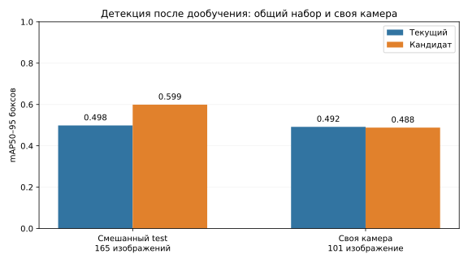

# Дообучение CountPeople и проверка ID/жилетки

Проверка 14 ноября 2026. **Основной детектор людей в `test2` не заменён:** кандидат
не прошёл проверки подсчёта. В профиль включён дообученный фильтр жилетки v3.
Локальные перескоки ID частично исправлены; надёжное часовое узнавание не достигнуто.
База PostgreSQL и рабочее состояние при экспериментах не использовались.

## Что обучалось

Детектор продолжен с `test2_person_v2/weights/best.pt`, архитектура прежняя.
Набор: 1692 train, 162 val, 165 test; 891 исходное изображение и 1128
фотометрических вариантов только в train. Из 694 внешних кадров сохранены 429,
265 сомнительных исключены; добавлены 42 проверенных пустых кадра только в train.
Разбиение собственных данных сохранено. Группы, исходники и одинаковые пиксели
не пересекают части подготовленного набора. Test не используется для обучения
или выбора эпохи. [Протокол данных](data_protocol.json).

Рецепт: CPU, 3 потока, 640 px, batch 4, AdamW, lr 0,0001, freeze 10, seed 42.
Из максимум 20 эпох выполнено 8; ранняя остановка после пяти эпох без улучшения.
Выбрана третья эпоха по mAP50–95 на val. Дополнительная финальная валидация
не является девятой эпохой обучения. [Журнал](person_training.csv),
[параметры](training_recipe.json), [выбор весов](selected_checkpoint.json).

Экспорт сохранён локально в `.local/countpeople_training/final/person.onnx`,
SHA-256 `9994115342b3c447ff7c857910c5f159f3d6bda7cb868af6dc7627d3888c6c0f`. Рабочие веса людей и OSNet не перезаписаны.
Источник внешних изображений: [CountPeople v12](https://universe.roboflow.com/ca-foscari-university-of-venice/countpeople/dataset/12).
В скачанном экспорте указана лицензия CC BY 4.0; изображения в Git не включены.

## Качество боксов — отдельно от подсчёта

На смешанном test mAP50–95 вырос с **0.498 до 0.599**. На части **своей
камеры** показатель составил **0.492 → 0.488**, улучшения нет.
При одинаковых confidence 0,30 и IoU 0,50 на всех 165 кадрах: TP 194 → 192,
лишние боксы 56 → 30, пропущенные боксы 36 → 38; F1 0,808 → 0,850.
Это метрики детекции, не точность пассажиропотока. На test всего шесть пустых
изображений; на них ложных боксов не было у обоих детекторов.



[Метрики по частям test](candidate_box_test.json), [исходный детектор](baseline_box_test.json),
[одинаковая рабочая точка](person_fixed_operating_point.json).

## Проверка проходов

Повторно обработаны 25 старых контрольных эпизодов и 8 ранее выбранных эпизодов
`test2`. Сравнивались исходный детектор, новый детектор, сочетание нового детектора
с жилеткой v3 и выпускаемый профиль. В `test2` сохраняются верные итоги всех **25/25**
старых эпизодов и исключение трёх известных настоящих проходов водителя.
Это регрессии/калибровка, а не независимая оценка текущей точности.

У нового детектора верны итоги **20/25** старых эпизодов.
Расхождения по итогам (они не заменяют проверку отдельных событий):

- `old_A04`: вручную 5/3, кандидат 4/3 IN/OUT.
- `old_A06`: вручную 2/5, кандидат 2/4 IN/OUT.
- `old_A10`: вручную 0/1, кандидат 0/0 IN/OUT.
- `old_A12`: вручную 4/4, кандидат 3/4 IN/OUT.
- `control_clip_03`: вручную 0/4, кандидат 0/3 IN/OUT.

На новых калибровочных эпизодах часть пропусков действительно уменьшилась:
P02 — 8 из 10 входов вместо 6; P03 — один из двух выходов вместо нуля.
Но P01 получил лишние события, а в V03/V05 перестало работать исключение водителя.
Одна замена жилетки на v3 при новых вырезках человека эти два случая не исправила.
Проверка по кадрам выявила:

- P01, 256248: пассажир в белой шапке уже вышел на 256222; новый ID дал второй OUT.
- P01, 256787: ID 50 после входа мужчины на 256742 перешёл к следующей входящей
  женщине и создал ложный OUT. Это два разных человека на одном треке.
- P01, около 256490: выход человека с бежевым капюшоном пропущен.
- P02: остаются пропущены мальчик и последний пассажир в зелёной куртке.
- P03: остаётся пропущен выход в белой шапке/сиреневой куртке.
- V02: проход мужчины без жилетки пропущен в обе стороны.

По просмотренным событиям этих восьми известных эпизодов: текущий профиль —
20 верных, 8 пропусков, 0 лишних; кандидат — **22 верных, 6 пропусков, 4 лишних**
(два из них — ошибочно включённые проходы водителя). Его 26 событий не означают
26 верных проходов из 28. F1 событий: 0,833 у текущего профиля и 0,815 у кандидата.
Эти цифры относятся к калибровочным эпизодам, не ко всему дню.

Следовательно, количество выданных событий нельзя делить на ручное число и
называть точностью: лишнее событие может скрывать пропуск. Увеличение подтверждения
зоны до трёх кадров и снижение confidence до 0,25 не решили регрессии.
Отдельно проверенная смесь 75% прежних / 25% новых весов создала ложный IN в P03;
она тоже не включена. [Все итоги и события](video_comparison.json),
[проверка конкретных ошибок](event_review.json).

## Жилетка v3

В отдельный набор добавлены 10 вручную просмотренных отрицательных вырезок P02
со светлой вставкой обычной одежды/переднего плана. Цвет исключён из входа:
детектор получает чёрно-белую картинку и ищет саму жилетку. Для исключения нужны
два последовательных подтверждения, confidence 0,20, ожидание дополнительного
ракурса до 10 секунд. Порог выбран на val и известных отрицательных примерах,
до обработки свежих P04/P05/S01. Оценка модели не является вероятностью роли.

Первую пробу остановили, обнаружив пересечение P02 с прежним garment test.
Перед окончательным обучением весь участок 260000–265500 убран из garment test:
13 изображений. Исходный набор v2 не изменён. В `train_garment` добавлена проверка
соседних исходных кадров между частями, которая отвергает первоначальный
набор с пересечением даже при разных названиях эпизодов.

Окончательное обучение: 287 train (52 жилетки, 235 отрицательных кадров),
81 val (4/77), 150 test (21/129); 9 эпох из максимум 20, лучшая четвёртая.
CPU 2 потока, 320 px, batch 8, lr 0,0001, freeze 10.
[Журнал](garment_training.csv), [метаданные весов](../../models/candidates/work_vest_v3.json).

На одинаковом отфильтрованном test: распознано **9/21** положительных кадров
вместо **5/21**, ложных срабатываний **0/129** у обеих версий. На val при выбранных
порогах — 2/4 вместо 1/4, FP 0/77. На десяти добавленных калибровочных вырезках
ошибки уменьшились с 3 до 0; это результат на знакомом эпизоде, не независимый test.
[Валидация](garment_validation.json), [кадровая проверка](garment_frame_test.json).

Кадровая полнота остаётся низкой: 12 из 21 положительного кадра пропущены.
На старом `old_A04` остаётся сомнительная метка STAFF у серо-белой области
переднего плана; счётного события там нет. Отсутствие ошибочно исключённых
проходов в контролях не означает отсутствия ошибочных статусов на каждом кадре.
Модель проверялась на одной камере и одной жилетке, не на всех видах формы.

## ID и дополнительные проверки

Для краткого пропадания детекции сохранение последнего ракурса расширено до пяти
шагов трекера. При восстановлении после 3–4 пропущенных кадров потерянный трек
не может перехватить подходящую непрерывно наблюдаемую траекторию. Иначе простое
ослабление порога теряло один выход в старом `clip_03`; этот вариант отклонён.
Проверены 33 текущих и 9 прежних кешей, отдельность ID считавшихся людей в старых
контролях и синтетическое часовое исключение повторов. Это не IDF1/HOTA.

**Долгосрочный ID остаётся слабым.** В old_A12 у двух вручную подтверждённых людей
ID входа и выхода не совпал. На S01 один реальный водитель и ложные/частичные
детекции породили 12 треков и 10 записей личности. После наклона тот же водитель
получает другую запись. Отложенная выдача ID, расширение галереи и исключение
сильно обрезанных вырезок не восстановили эти проверенные пары; в выпуск они
не вошли. OSNet не дообучалась: в CountPeople нет меток идентичности/возвратов.
Нельзя утверждать, что правило часа надёжно работает на реальных возвращениях.

Дополнительно **до предсказаний** вручную зафиксированы P04/P05 — 7 пассажирских
проходов — и S01 с водителем без настоящего прохода через дверь. Они не использовались
для обучения или выбора выпускаемых параметров. На P04 текущий и обновлённый
профили дали 0 IN / 3 OUT при ручных 1/4; на P05 — верные 1/1. Итого **5/7**
верных проходов, без лишних пассажирских событий. В S01 итог 0/0: два ложных
геометрических перехода при наклоне отсеяны жилеткой. Это не два настоящих
прохода водителя и не доказательство исправления трекинга.
[Замороженная разметка](manual_holdout.json), [разметка персонала](manual_staff_holdout.json),
[параметры до проверки](improved_profile_frozen.json), [результаты](additional_holdout_results.json).

Видео `test2.mp4` содержит монтаж и скачки вписанных часов. Используется шкала
видеофайла; реальный час по таким участкам не подтверждён. Полные 425194 кадра
не прогонялись, дневная точность и статистика за весь день не заявляются.

## Скорость короткого прогона

На P01 (801 кадр) без параллельных обучений, GUI и сохранения видео:
**15.5 FPS** у прежнего фильтра жилетки и
**17.7 FPS** у выпускаемого профиля,
CPU 4 потока. Итоги у обоих 3 IN / 11 OUT. Это один последовательный замер,
не гарантия скорости для всех сцен или потока 60 FPS. [Условия и время этапов](performance.json).

## Запуск и проверки

Рабочий экспериментальный профиль (обновлена жилетка, детектор людей прежний):

```powershell
.\venv\Scripts\python.exe test_local.py --source data/test2.mp4 --profile test2 --show
```

Для отдельного просмотра отклонённого детектора добавить
`--model .local/countpeople_training/final/person.onnx`. Его не следует подставлять
в рабочую службу на основании выросшего mAP. Предыдущие параметры профиля
сохранены в [историческом снимке](../test2-2026-11-13/profile_snapshot.json);
[выпускаемый профиль](released_profile.json). Существующая `.env` не изменена.
Службе с иными весами нужен совместимый отдельный STATE_PATH; рабочее состояние
и очередь нельзя удалять для обхода этой проверки.

Выполнено 130 тестов: 119 прошли, 11 пропущены; проверки локальных кешей включены.
PostgreSQL и полный видеопрогон — отдельные не включённые проверки.
`tools.check_repository` проверяет восемь моделей, контрольные суммы, отсутствие
секретов/частных данных и ссылки документации. Локальные визуализации находятся
в `.local/countpeople_training/released_actual/` (P02, S01, striped_jacket).

[Наблюдения ID до и после возвращения](identity_observations.json).

В `test_local.py --show` итог при EOF перерисовывается после выдачи отложенных
событий. В диагностических файлах `evaluate_clip` окончательным является JSON:
последний кадр сохранённого видео может предшествовать выдаче этих событий.
